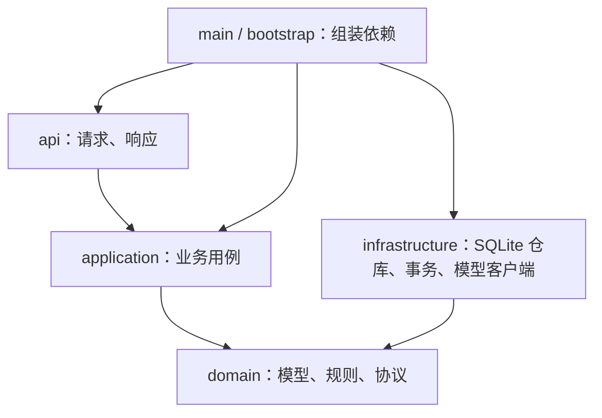

# Flash Training 架构与开发入口

本轮目标是改善可维护性和数据一致性，保留页面与接口行为。数据库仍使用已有 SQLite v1，没有重建数据库、重新导入 JSON 或添加业务功能。

## 1. 依赖方向

业务通过协议使用存储和模型能力，不导入 SQLite、FastAPI 或 OpenAI SDK。实际启动时由 `main.py` 创建数据库和模型适配器，再由 `bootstrap.py` 组装独立服务。测试可以使用临时数据库、替代模型或只实现所需仓库方法的内存对象。

## 2. 各层负责什么

| 位置 | 负责 | 主要入口 |
| --- | --- | --- |
| `api/skills.py`、`practice.py`、`progress.py` | 接收请求、调用服务、保持前端响应格式 | 各 HTTP 路由 |
| `api/dependencies.py` | 注入明确类型的服务 | Skills / Practice / Progress / Records |
| `api/responses.py` | 响应包装与错误结构 | Success[T] 等 |
| `domain/commands.py` | 输入限制、禁止多余字段、分值和空值检查 | SkillCreate、SubmitRequest 等 |
| `domain/models.py` | 技能、原子、会话、成绩与进度的数据约定 | Skill、PracticeSession、Evaluation 等 |
| `domain/ports.py` | 专用仓库、事务和模型客户端协议 | UnitOfWorkFactory、JSONClient |
| `domain/learning.py` | 掌握度计算和时间合法性 | next_mastery、event_time |
| `application/skills.py` | 技能增删改、原子定义、AI 创建技能整体保存 | SkillService |
| `application/practice.py` | 生成、开始、提交、幂等处理、会话恢复和历史 | PracticeService |
| `application/progress.py` | 自评、掌握度、曲线、技能映射、启发式推荐、优化建议 | ProgressService |
| `application/records.py` | 回放列表、软删除、当前档案、统计 | RecordService |
| `application/content.py` | 模型任务说明、结构和分项评分完整性校验 | ContentService |
| `application/learning.py` | 在已有事务内写学习表现，用于练习提交和手工掌握度 | record_performance |
| `infrastructure/repositories/` | SQL 查询、行映射和数据库序列化 | Skill / Practice / Progress / User Repository |
| `infrastructure/unit_of_work.py` | 一次操作共用一个连接，统一提交与回滚 | SQLiteUnitOfWorkFactory |
| `infrastructure/database.py` | 表结构、连接、只读保护和数据库版本 | Database |
| `infrastructure/legacy_import.py` | 原 JSON 的一次性事务迁移与归档 | migrate_legacy |
| `infrastructure/ai.py` | SDK、地址、鉴权、超时、供应商错误转换 | OpenAIJSONClient |
| `manage.py` | 人工管理命令；不参与 HTTP 业务 | migrate / inspect / backup |

原来的通用 `services.py`、`repository.py` 已移除，不保留一个转发所有业务的兼容服务。前端接口路径保留兼容别名。

## 3. 一次提交如何保证一致

`PracticeService.submit()` 分成三个阶段：

1. 在读事务中读取属于该用户的会话、题目、技能快照、有效参数与原子技能定义。已完成且答案相同则返回保存的结果，答案不同则返回 409。
2. 关闭事务后调用模型；以严格的 `Evaluation` 校验结果，分项评分必须与会话快照里的原子技能集合完全一致。
3. 开启写事务，重新检查会话状态，取得写锁后生成完成时间。写入答案、会话完成状态、回放记录、原子得分和掌握度事件。所有仓库共享这一个连接，成功退出才提交，任一步异常则整体回滚。

并发请求会在写阶段再次检查会话，只会保存一份成绩。仍可能有两次模型请求；本轮没有实现分布式模型请求去重。出题和自定义技能也在模型请求后重新验证技能状态/名称冲突。

`read()` 启用 SQLite 只读保护；仓库没有 `commit()`。HTTP 路由不打开事务，也不获取连接。业务服务决定哪些操作属于同一次事务，基础设施决定怎样提交或回滚。

## 4. 类型与历史兼容

新的出题结果使用 `PracticeContent`，新评分使用 `Evaluation`；布尔分数、越界、空白反馈和遗漏的原子评分会失败。业务服务返回类型对象，HTTP 通过响应模型序列化。

旧会话可能缺少参考答案，旧评估结构也不固定，因此历史题目使用 `StoredContent`，历史评分快照允许 JSON 对象。旧难度字段有数字，读取时保留原值。回放模型列出主要字段，并允许保留旧扩展字段；身份、关联、分数与时间始终以数据库独立列为准。兼容规则仅用于保留旧数据，不能绕过新模型评分校验。

`JsonObject` 限制可变参数为合法 JSON 值，不再将任意 Python 对象作为参数传递。SQL 行和 JSON 字符串在仓库内转换，业务无需解析 `content_json`、`result_json` 等存储字段。

## 5. 后续修改从哪里开始

- 改 API 密钥、模型 ID、地址：`backend/.env.ai`，重启后端。
- 改 SDK 请求：`infrastructure/ai.py`，搜索 `GPT API EDIT POINT`。
- 改出题/评分任务：`application/content.py`，同步检查结果模型与测试。
- 改掌握度算法：`domain/learning.py`。已有事件需明确迁移/重算策略，不能只改计算公式后混用历史值。
- 新增知识原子/图谱：先确定 `domain` 数据与先修关系，新增数据库版本和仓库协议，再实现独立业务用例。避免把图谱逻辑直接放入路由。
- 新增 Agent：由新的应用用例编排已有能力，遵守现有事务边界；模型生成的结果不能直接当成数据库写入命令。

新增常规功能时，按“模型与命令 → 协议/仓库 → 服务 → 路由/响应 → 测试”的顺序实现。已有 SQLite v1 的 DDL 不应原地修改；需要表结构变化时编写版本升级迁移。

## 6. 本轮验证与边界

- 44 项后端测试通过：保留原 30 项行为测试，新增 14 项结构与行为检查，包括依赖方向、路由响应模型、只读保护、模型调用不占用事务、自评隔离、历史兼容和生成期间技能删除。
- 7 项前端测试、TypeScript 类型检查与生产构建通过；ESLint 为 0 错误、6 个既有热更新导出警告。
- 新版启动后比较了 120 份真实只读接口响应，已有字段和值与重构前一致。
- 现有数据库完整性正常、外键违规为 0，7 个用户、14 个技能、22 条回放记录和 13 个会话可读取。没有使用测试练习污染现有数据，也没有新增付费模型调用。
- 额外代码与在线数据库备份在工作区 `work/architecture-backup-20261106-005530/`。

这证明结构约束和已有流程通过本轮验证，不代表已经完成多人权限、完整浏览器端到端、移动真机或学习效果验证。分页、请求级幂等、模型评分校准和账号认证仍为后续独立工作。
